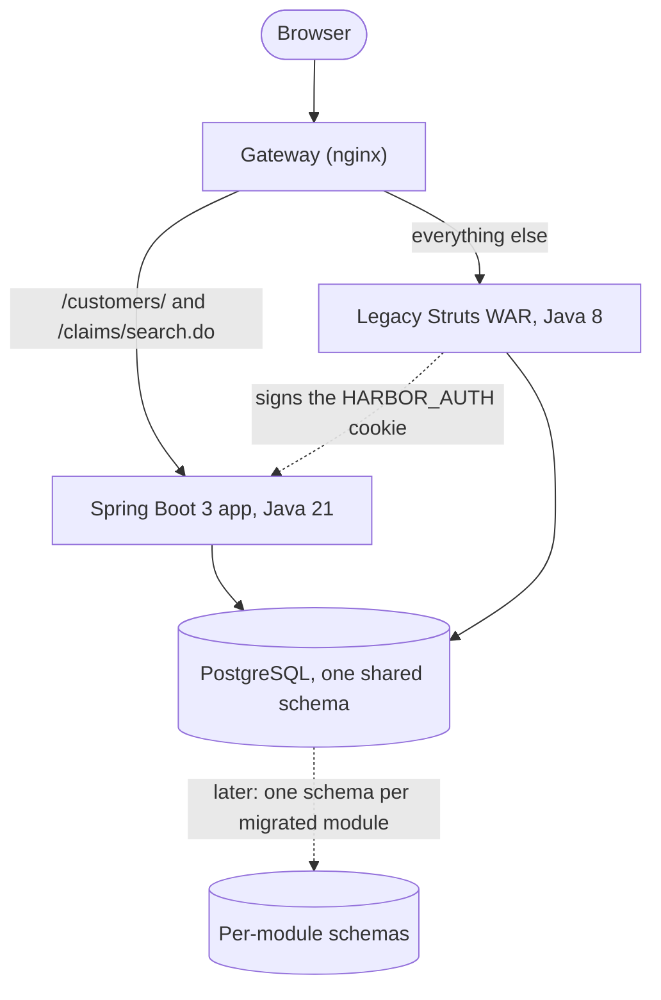

# legacy-java-modernization-kit

A fictional Struts 1 / Java 8 insurance portal, a toolkit that **assesses** it and writes the modernization report, and a **strangler-fig migration** that moves two modules to Spring Boot 3 while the rest keeps running. No big-bang rewrite.

[](https://github.com/muralikalluri/legacy-java-modernization-kit/actions/workflows/ci.yml)


> **Deliberately insecure for demonstration. Do not deploy.** `legacy-app/` carries seeded security flaws on purpose. All companies, people and data are fictional.


## Results

Generated from the committed files in `assess/results/` by `assess report`; nothing here is typed by hand.

<!-- results:start (generated by assess report, do not edit) -->

| Result | Value | Source |
|---|---|---|
| System size | 35 Struts actions, 25 JSPs, 74 Java files, 5360 lines | `assess/results/inventory.json` |
| Seeded security findings | 17 sites in 5 categories | `assess/results/security.json` |
| Vulnerable dependencies | 36 advisories in the WAR, 8 libraries end of life, unmaintained or superseded (6 critical and 20 high advisories across the WAR and the container) | `assess/results/deps.json` |
| Structure | 1 God class (1122 lines), 2 package cycles | `assess/results/structure.json` |
| javax to jakarta | 45 files change in an OpenRewrite dry run; 91 imports move | `assess/results/jakarta.json` |
| Estimated effort | 88.5 to 225 ideal person-days (12.5 to 32.5 calendar weeks, 2 developers) | `assess/results/estimate.json` |

<!-- results:end -->

Effort is a low-to-high band in ideal person-days, built from labelled assumptions in `assess/estimation-model.yaml`; it is an input-driven estimate, not a measurement. The proof that the migration is safe is behavioural: one characterisation suite ([ADR 0004](docs/adr/0004-characterization-contract.md)) passes against the legacy app and, unchanged, through the gateway to the Spring Boot app. CI runs both.

## Architecture



## Quickstart

Needs Docker, and JDK 21 for the toolkit and the tests.

```bash
cp .env.example .env                    # required: the compose file refuses the placeholder auth secret without it
docker compose down -v                  # only if you have a database volume from an earlier version of this repo
docker compose up -d --build            # postgres, migrations, legacy app, modern app, gateway
open http://localhost:8500/             # the gateway: Customers and claim search are Spring Boot 3, the rest is legacy
open http://localhost:8501/             # the legacy app on its own (deliberately insecure, see the banner)
```

`docker compose up -d --build postgres legacy` starts only the legacy app. The published ports come from `.env` (`GATEWAY_PORT`, `LEGACY_PORT`, `MODERN_PORT`, `POSTGRES_PORT`); change them if something else already uses 8500 to 8502 or 8532. Demo logins (plaintext on purpose, fictional): `admin`, `adjuster1`, `adjuster2`, `supervisor1`, `underwriter1`, `csr1`, `auditor1`; the password is the username plus `-demo`.

```bash
scripts/smoke-strangler.sh                                                         # routing, cookies, redirects, spoofed headers, logout, through the gateway
characterization-tests/run.sh                                                      # the suite against legacy (:8501)
characterization-tests/run.sh --target modern --base-url http://localhost:8500     # the same suite through the gateway
mvn -f modern-app verify                                                           # modern app tests (Testcontainers)
./assess/run-all.sh                                                                # inventory, deps, jakarta, structure, security, estimate, report
./assess/run-all.sh --offline                                                      # no network: cached OSV data, committed OpenRewrite result
./assess/make-pdf.sh                                                               # PDFs of the sample deliverables (pandoc + Chrome)
scripts/reset-db.sh                                                                # truncate and reseed the demo database
```

## Features

- **A realistic legacy target.** Struts 1.3, Tiles, JSP scriptlets, JDBC with string-built SQL, a log4j 1.x logger, Quartz 1.x, iText 2, a homegrown login filter. It compiles and runs on Java 8 in Tomcat. Seeded flaws: SQL injection, missing CSRF, plaintext passwords, missing role checks on admin actions, session fixation, vulnerable dependencies, a God class and package cycles.
- **Assessment toolkit (`assess/`, picocli).** `inventory`, `deps` (OSV, cached), `jakarta` (javax counts plus an OpenRewrite dry run), `structure` (jdeps, cycles, fan-in/out), `security` (Semgrep, cross-referenced with the inventory), `estimate` (rates and multipliers from a YAML model, with sensitivity), `report`. Output is byte-identical when regenerated, and CI fails if a committed result or deliverable is stale.
- **Strangler migration.** Customers and the claim search run in Spring Boot 3 (constructor injection, record DTOs, parameterised `JdbcClient`, Spring Security 6, Thymeleaf, Flyway baseline on the legacy schema). The seeded flaws in those modules are fixed, and the divergences are pinned by tests rather than hidden.
- **Auth bridge.** Legacy signs a `HARBOR_AUTH` cookie; the modern app verifies it, takes the role from the database on every request, and honours per-login logout revocation.
- **Characterisation tests first.** The same suite runs against both targets; tests that must differ are listed as named divergences, and a contract guard stops a test from branching on the target.

## Design decisions

| Decision | Why | Record |
|---|---|---|
| Legacy issues the cookie; there is no separate auth service | One place to get sign-in wrong, not two | [ADR 0005](docs/adr/0005-auth-bridge-and-strangler-gateway.md) |
| Role and active flag come from the database, never from the cookie | A forged or stale cookie cannot grant authority | ADR 0005 |
| Logout revokes one login (`sid`), not the user | Other logins of the same user keep working | ADR 0005 |
| No HTTP session in the modern app | Both apps share a host and path `/`; a second `JSESSIONID` would sign users out of legacy | ADR 0005 |
| Gateway clears client `X-Forwarded-*` headers and keeps redirects relative | Nothing builds an absolute URL from a spoofable header | ADR 0005 |
| `/claims/search.do` matched exactly, `/customers/` as a prefix | The real URL has `.do`; unmigrated paths must keep reaching legacy | ADR 0005 |
| Flyway runs as a one-shot service with the owner account | The app containers never hold DDL rights | ADR 0005 |
| The characterisation contract and its known divergences | Proves behaviour is preserved except where a flaw was fixed on purpose | [ADR 0004](docs/adr/0004-characterization-contract.md) |
| Effort bands, risk scoring and the report are generated | Report numbers can only come from tool output | [ADR 0002](docs/adr/0002-assessment-toolkit-decisions.md), [ADR 0003](docs/adr/0003-estimation-risk-and-report-decisions.md) |
| Legacy business rules recorded before any migration | Rules that live only in code are a risk in their own right | [ADR 0001](docs/adr/0001-legacy-business-rules.md) |

## Sample deliverable

What a client receives, generated by `assess report` from this repository:

| File | Tier | Content |
|---|---|---|
| [`QUICK_ASSESSMENT.md`](sample-deliverable/QUICK_ASSESSMENT.md) ([PDF](sample-deliverable/QUICK_ASSESSMENT.pdf)) | Starter | Inventory, top risks, CVE summary, approach, rough effort band |
| [`ASSESSMENT_AND_ROADMAP.md`](sample-deliverable/ASSESSMENT_AND_ROADMAP.md) ([PDF](sample-deliverable/ASSESSMENT_AND_ROADMAP.pdf)) | Standard / Advanced | Inventory, risk register, framework mapping, module scoring and migration order, target architecture, phased roadmap, effort estimate, security gaps, raw outputs |

The PDFs carry a creation date, so unlike the Markdown they are not part of the byte-for-byte check in CI.

## Limits and what is not here

- The nightly policy-expiry job is off by default (`HARBOR_JOBS_ENABLED=false`): one real run lapses every seeded policy.
- Plain http only; for https set `HARBOR_COOKIE_SECURE=true` (see ADR 0005, "Not covered").
- The legacy admin flaws (any signed-in user can create users) stay visible through the gateway on purpose: they are Phase 0 work in the roadmap.
- Milestones M0 to M7 (the MVP in `SPEC.md` section 7) are all built. Where the build differs from the SPEC text, the difference is deliberate and recorded:
  - the claim search route is `/claims/search.do`, matched exactly, not `/claims/search/**`;
  - there is no separate shared auth endpoint: legacy issues the signed cookie;
  - the modern app uses `JdbcClient` rather than Spring Data JDBC or JPA;
  - the characterisation tests are plain HTTP tests (Java), not Playwright;
  - the reports are in `sample-deliverable/` rather than `report/`.
- Milestone M8 (OpenRewrite applied to one module in a branch) is marked "Later" in `SPEC.md` and is not built; the dry run is reported, not applied.

## Hire me

If you need a modernization assessment and roadmap like this for your own Java system: [hire me on Upwork](https://www.upwork.com/freelancers/~01c80d5fd70c92b97d?mp_source=share).
