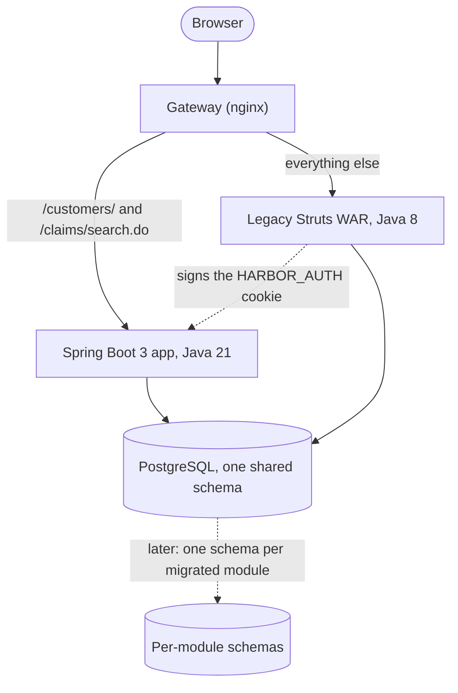
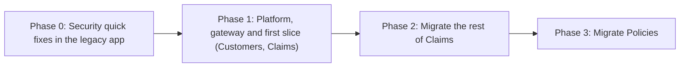

# Assessment and roadmap: Harbor Claims Portal (legacy Java)

> Fictional demo system. Everything below is generated from `assess/results/` by `assess report`. Nothing is typed by hand. Vulnerability data as of 2026-10-05. The short version of this report is `QUICK_ASSESSMENT.md`.

## Executive summary

The portal has 35 Struts actions across 5 business modules plus a shared platform, 25 JSPs and 74 Java files (5360 lines). Move Customers first. Leave Reports and Admin alone. Migrating the modules worth moving (Reports and Admin are left alone) is roughly 88.5 to 225 ideal person-days, about 12.5 to 32.5 calendar weeks for 2 developers.

**Recommendation.** Use a strangler-fig migration. Customers can move first: coupling to the rest of the code is low, so it can be cut out with the least untangling. Fix the security findings in the legacy app first (Phase 0), then stand up the platform and move the first slice.

The first slice is not a plan on paper. 7 actions (every Customers action and the claim search) already run in a Spring Boot 3 app behind a gateway, next to the unchanged legacy app, and the same characterisation suite passes against both. See `docs/adr/0004-characterization-contract.md` and `docs/adr/0005-auth-bridge-and-strangler-gateway.md`.

| Phase | Work | Effort (ideal person-days) |
|---|---|---:|
| 0 | Security quick fixes in the legacy app | 14 to 37.5 |
| 1 | Platform, gateway and first slice (Customers, Claims) | 48.5 to 115 |
| 2 | Migrate the rest of Claims | 8.5 to 23.5 |
| 3 | Migrate Policies | 17.5 to 49 |

Left alone and not in the total, with the cost of migrating them in brackets: Reports (13 to 35), Admin (13.5 to 35.5).

Ranked by likelihood times impact, one entry per root cause. At most 3 entries come from any one group, so the list is not just the worst CVEs. The full register has 17 entries in `assess/results/risks.json`.

6 risks were left out of this list by the per-group cap: quartz 1.8.6; struts-core, struts-extras, struts-taglib, struts-tiles 1.3.10; itext 2.1.7; commons-beanutils 1.8.0; bcmail-jdk14, bcprov-jdk14, bctsp-jdk14 1.38; State-changing forms without an anti-CSRF token (CWE-352).

| Rank | Risk | Evidence | Score |
|---:|---|---|---:|
| 1 | SQL built by string concatenation (CWE-89) | 3 query sites | 25 |
| 2 | Passwords stored and compared in plaintext (CWE-256) | 1 comparison site | 20 |
| 3 | postgresql 42.2.27 (provided by the container, not in the WAR) | 3 advisories (1 critical, 1 high, 1 medium) | 20 |
| 4 | commons-collections 3.2.1 | 2 advisories (1 critical, 1 high); superseded | 20 |
| 5 | log4j 1.2.17 | 6 advisories (3 critical, 3 high); end of life since 2015-08-05 | 20 |
| 6 | Admin actions without a role check (CWE-862) | 2 actions | 20 |
| 7 | Struts 1 has no Jakarta build, so it blocks a javax to jakarta upgrade | 91 javax.servlet imports in 42 files | 20 |
| 8 | Business rules are recorded only in code | assumption, confirm with the client | 12 |
| 9 | God class | ClaimManager (1122 lines) | 10 |
| 10 | Package dependency cycles | 2 cycles: auth + common; claims + customers + policies | 10 |

## System inventory

| Module | Actions | JSPs | Java files | Java lines | Scriptlet blocks |
|---|---:|---:|---:|---:|---:|
| Customers | 6 | 3 | 9 | 620 | 5 |
| Claims | 6 | 3 | 14 | 1963 | 2 |
| Policies | 7 | 3 | 16 | 1200 | 5 |
| Reports | 5 | 4 | 7 | 273 | 0 |
| Admin | 7 | 4 | 10 | 536 | 0 |
| Platform | 4 | 8 | 18 | 768 | 31 |
| **All modules** | **35** | **25** | **74** | **5360** | **43** |

- 35 action mappings (2 are plain forwards, 31 custom action classes), 8 form beans and 20 Tiles definitions.
- 25 JSPs with 43 scriptlet blocks (26 scriptlets, 17 expressions, 0 declarations).
- 6 roles held in a database table: admin, adjuster, supervisor, underwriter, csr, auditor.
- Request filters, in order: encoding, login. Roles are checked per action with the Struts roles attribute on 21 of 35 mappings.
- 6 DAOs and 6 managers over plain JDBC. Integrations found: JNDI DataSource, PostgreSQL JDBC driver (container-provided), Quartz scheduler (nightly batch), Struts 1 MVC, Tiles 1 page layout, iText PDF export, log4j 1.x logging.

Roles and the actions that declare them:

| Role | Actions declaring it |
|---|---:|
| admin | 21 |
| adjuster | 4 |
| supervisor | 10 |
| underwriter | 4 |
| csr | 5 |
| auditor | 5 |

14 mappings have no roles attribute. That means three different things (public page, any signed-in user, or a flaw); only the admin mappings are judged as flaws.

Integrations found:

| Integration | Evidence |
|---|---|
| JNDI DataSource | web.xml resource-ref jdbc/HarborDS |
| PostgreSQL JDBC driver (container-provided) | pom: org.postgresql:postgresql 42.2.27 scope provided |
| Quartz scheduler (nightly batch) | pom: org.quartz-scheduler:quartz 1.8.6 |
| Struts 1 MVC | pom: org.apache.struts:struts-core 1.3.10 |
| Tiles 1 page layout | pom: org.apache.struts:struts-tiles 1.3.10 |
| iText PDF export | pom: com.lowagie:itext 2.1.7 |
| log4j 1.x logging | pom: log4j:log4j 1.2.17 |

## Risk register

Likelihood and impact run from one to five and are judgements, kept with a rationale in `assess/reference/risk-rules.yaml`. Counts and evidence are measured from the code. Entries marked assumption are not measured and need confirming with the client.

| Rank | Group | Risk | Evidence | Likelihood | Impact | Score | Basis |
|---:|---|---|---|---:|---:|---:|---|
| 1 | Application security | SQL built by string concatenation (CWE-89) | 3 query sites | 5 | 5 | 25 | measured |
| 2 | Application security | Passwords stored and compared in plaintext (CWE-256) | 1 comparison site | 4 | 5 | 20 | measured |
| 3 | Dependencies | postgresql 42.2.27 (provided by the container, not in the WAR) | 3 advisories (1 critical, 1 high, 1 medium) | 4 | 5 | 20 | measured |
| 4 | Dependencies | commons-collections 3.2.1 | 2 advisories (1 critical, 1 high); superseded | 4 | 5 | 20 | measured |
| 5 | Dependencies | log4j 1.2.17 | 6 advisories (3 critical, 3 high); end of life since 2015-08-05 | 4 | 5 | 20 | measured |
| 6 | Dependencies | quartz 1.8.6 | 1 advisory (1 critical); superseded | 4 | 5 | 20 | measured |
| 7 | Application security | Admin actions without a role check (CWE-862) | 2 actions | 5 | 4 | 20 | measured |
| 8 | Platform | Struts 1 has no Jakarta build, so it blocks a javax to jakarta upgrade | 91 javax.servlet imports in 42 files | 5 | 4 | 20 | measured |
| 9 | Dependencies | struts-core, struts-extras, struts-taglib, struts-tiles 1.3.10 | 6 advisories (5 high, 1 medium); end of life since 2013-04-05 | 4 | 4 | 16 | measured |
| 10 | Dependencies | itext 2.1.7 | 1 advisory (1 high); unmaintained since 2009 | 3 | 4 | 12 | measured |
| 11 | Dependencies | commons-beanutils 1.8.0 | 3 advisories (3 high) | 3 | 4 | 12 | measured |
| 12 | Dependencies | bcmail-jdk14, bcprov-jdk14, bctsp-jdk14 1.38 | 17 advisories (6 high, 10 medium, 1 low) | 3 | 4 | 12 | measured |
| 13 | Application security | State-changing forms without an anti-CSRF token (CWE-352) | 10 POST forms | 4 | 3 | 12 | measured |
| 14 | Knowledge | Business rules are recorded only in code | assumption, confirm with the client | 4 | 3 | 12 | assumption |
| 15 | Structure | God class | ClaimManager (1122 lines) | 5 | 2 | 10 | measured |
| 16 | Structure | Package dependency cycles | 2 cycles: auth + common; claims + customers + policies | 5 | 2 | 10 | measured |
| 17 | Application security | Session id not renewed at login (CWE-384) | 1 site | 3 | 3 | 9 | measured |

## Framework mapping

| Legacy construct | Spring Boot target | Found in this app | Migration notes |
|---|---|---|---|
| Struts Action (one class per mapping) | @Controller or @RestController method | 31 action classes for 35 mappings | Charged per distinct action class, not per mapping: several mappings often share one class. ForwardAction mappings become a view name or a redirect. |
| ActionForm and validate() | Java record DTO with Bean Validation | 8 form beans | Keep the legacy validation rules exactly, then pin them with characterisation tests before tightening anything. |
| Tiles definitions and JSP with scriptlets | Thymeleaf template with a layout dialect | 20 Tiles definitions, 43 scriptlet blocks | Scriptlets become model attributes prepared in the controller. Output escaping becomes the default instead of something each page remembers. |
| JDBC DAO with string-built SQL | JdbcClient or Spring Data JDBC with bound parameters | 6 DAOs | The SQL injection sites disappear by construction. Keep the SQL shape like for like first; improve queries in a later pass. |
| Manager singleton and session facade | @Service with constructor injection | 6 managers | Break the God class along the business seams the characterisation tests expose, not along file size. |
| JNDI DataSource lookup | Spring Boot DataSource configuration with Hikari | 1 JNDI resource | Credentials come from the environment or a secret store, never from the image. |
| web.xml filters (encoding, homegrown login) | SecurityFilterChain with Spring Security | 2 filters | Role rules move out of the actions and into one place, so a missing role check cannot hide in one class. |
| Session role checks inside actions | Request matchers plus method security on services | 6 roles | Two layers: the filter chain refuses early, method security is the second line. |
| Plaintext password comparison | DelegatingPasswordEncoder (bcrypt) | not counted | Needs a one-time credential migration and a forced reset path; plan it in Phase 0 because it also runs in the legacy app. |
| Quartz 1.x job | Spring scheduling with a lock for overlap protection | 1 listener that starts the scheduler | Keep run history. Decide the cluster story before the first deploy, not after. |
| iText 2 PDF export | A maintained PDF library behind a small interface | not counted | Compare the generated PDFs page by page; layout drift is the usual surprise. |
| log4j 1.x | SLF4J with Logback (the Boot default) | not counted | Replace the configuration, then check that no message formatting relied on log4j-specific layouts. |
| javax.\* imports | jakarta.\* namespace | 91 imports that move in 42 files | An OpenRewrite recipe does the mechanical part. Struts 1 has no Jakarta build, so the legacy app cannot take it: the new code takes it. |

## Module scoring and migration order

Claims: Only the in-scope actions move first (the M6 proof slice); the rest follows its score. Business values are assumptions to confirm with the client.

| Module | Business value | Coupling per class | Band | Decision | Phase |
|---|---:|---:|---|---|---|
| Customers | 3 | 0.44 | LOW | Migrate first | Phase 1 |
| Claims | 5 | 1.07 | MEDIUM | Migrate later (first slice only) | Phase 1 |
| Policies | 4 | 1.25 | MEDIUM | Migrate later | Phase 3 |
| Reports | 2 | 1.14 | MEDIUM | Leave alone | none |
| Admin | 1 | 0.5 | LOW | Leave alone | none |

**Migrate first**

- Customers: business value 3, coupling low (0.44 cross-module edges per class), 2 seeded risk sites.

**Migrate later**

- Claims: business value 5, coupling medium (1.07 cross-module edges per class), 4 seeded risk sites.
- Policies: business value 4, coupling medium (1.25 cross-module edges per class), 3 seeded risk sites.

**Leave alone**

- Reports: business value 2, coupling medium (1.14 cross-module edges per class), 0 seeded risk sites.
- Admin: business value 1, coupling low (0.5 cross-module edges per class), 5 seeded risk sites.

Structure behind the scoring (instability is fan-out over fan-in plus fan-out, in percent):

| Module | Classes | Lines | Fan-in | Fan-out | Instability % |
|---|---:|---:|---:|---:|---:|
| Customers | 9 | 620 | 1 | 2 | 67 |
| Claims | 14 | 1963 | 2 | 2 | 50 |
| Policies | 16 | 1200 | 4 | 3 | 43 |
| Reports | 7 | 273 | 1 | 3 | 75 |
| Admin | 10 | 536 | 0 | 3 | 100 |
| Platform | 18 | 768 | 5 | 0 | 0 |

- Module cycle: Claims, Customers, Policies.
- Package cycle: auth, common, with 3 witness edges.
- Package cycle: claims, customers, policies, with 13 witness edges.

Largest classes (a God class starts at 1000 lines):

| Class | Module | Lines | God class |
|---|---|---:|---|
| ClaimManager | Claims | 1122 | yes |
| ClaimDao | Claims | 236 | no |
| PolicyDao | Policies | 204 | no |
| CustomerForm | Customers | 200 | no |
| PolicyManager | Policies | 140 | no |

## Target architecture

- The gateway matches `/customers/` as a prefix and `/claims/search.do` exactly. Everything else goes to the legacy app, so a path nobody migrated keeps working.
- Legacy is the only place anyone signs in. It issues a signed cookie; the Spring Boot app verifies it and reads the role from the database on every request, never from the cookie.
- Both apps share one PostgreSQL schema at first. Splitting the data per module is a later step, taken only when a module has moved completely, because a shared schema is what makes the first slice cheap and safe.

## Phased roadmap

### Phase 0: Security quick fixes in the legacy app

Close the seeded security flaws in the legacy app before anything is built next to it, so the migration starts from a defensible base.

- Modules touched: Legacy
- Effort: 14 to 37.5 ideal person-days
- Exit criterion: The security scan reports no sites for the fixed categories and the legacy smoke test is green.

### Phase 1: Platform, gateway and first slice (Customers, Claims)

Stand up the platform: gateway, auth bridge, the Spring Boot app, Flyway baseline, and the characterisation harness. Move the first slice through it.

- Modules touched: Platform, Customers, Claims, Policies
- Effort: 48.5 to 115 ideal person-days
- Exit criterion: The characterisation suite passes unchanged against legacy and through the gateway.

### Phase 2: Migrate the rest of Claims

Move the next module behind the gateway, one slice at a time, behind characterisation tests.

- Modules touched: Claims
- Effort: 8.5 to 23.5 ideal person-days
- Exit criterion: The same suite passes through the gateway for the module's routes, then the legacy code for it is removed.

### Phase 3: Migrate Policies

Move the next module behind the gateway, one slice at a time, behind characterisation tests.

- Modules touched: Policies
- Effort: 17.5 to 49 ideal person-days
- Exit criterion: The same suite passes through the gateway for the module's routes, then the legacy code for it is removed.

## Effort estimate

Migrating the modules worth moving (Reports and Admin are left alone) is roughly 88.5 to 225 ideal person-days, about 12.5 to 32.5 calendar weeks for 2 developers.

By module, across all phases:

| Module | Effort (ideal person-days) |
|---|---:|
| Legacy | 14 to 37.5 |
| Platform | 21 to 40 |
| Customers | 12.5 to 37 |
| Claims | 21.5 to 55.5 |
| Policies | 19.5 to 55 |

By phase and module:

| Phase | Module | Effort (ideal person-days) |
|---:|---|---:|
| 0 | Legacy | 14 to 37.5 |
| 1 | Platform | 21 to 40 |
| 1 | Customers | 12.5 to 37 |
| 1 | Claims | 13 to 32 |
| 1 | Policies | 2 to 6 |
| 2 | Claims | 8.5 to 23.5 |
| 3 | Policies | 17.5 to 49 |

Approaches compared:

| Approach | Verdict | Effort (ideal person-days) | Why |
|---|---|---|---|
| Strangler fig behind a gateway | Recommended | 88.5 to 225 | Legacy and Spring Boot 3 run side by side. Modules move one at a time behind characterisation tests, so risk is spread and nothing waits for a final cutover. |
| Big-bang rewrite | Not recommended | 94.5 to 243.5 | Its band also covers the modules the strangler plan leaves alone. For the same modules it is 68 to 173 on paper, because it skips the gateway, the bridge and the Phase 0 double work. The catch: every module, the God class and the cycles must be solved before anything ships, and nothing is released until it is all done. |
| Lift: upgrade Java and the container in place | Blocked | not applicable | Struts 1 has no Jakarta build. The OpenRewrite dry run would change 45 files, yet struts-core would still need javax.servlet (91 imports in 42 files). |

The inputs the total is most sensitive to, largest first (change in the midpoint, in ideal person-days, when the input is halved and when it is raised by half):

| Input | Halved | Raised by half |
|---|---:|---:|
| rates.actionClass | -17.5 | +17.8 |
| fixed.platform | -7 | +7 |
| surcharges.godClass | -5.8 | +5.8 |
| rates.jsp | -5.5 | +5.3 |
| rates.manager | -5.3 | +5 |

Charging the action-class rate per mapping instead of per distinct class would give 90.5 to 231 ideal person-days in total, a difference of 2 to 6.

Calendar time assumes 2 developers. A workable split: one engineer owns Phase 0, the gateway, the auth bridge and the characterisation harness; the other migrates module by module behind those tests. Someone on the client side must be reachable to answer business-rule questions, because the rules live only in code.

Assumptions:

- Effort is in ideal person-days as a low to high band. Bands add lows and highs separately: a hard band, not a confidence interval.
- Calendar time assumes 2 developers at a focus factor of 0.7.
- Unit rates, multipliers and business values are labelled assumptions in `assess/estimation-model.yaml`, each with a rationale. They are inputs, not measurements.
- Fixes made in the legacy app in Phase 0 are partly thrown away when the code is rewritten: deliberate double work.

There is no Jakarta-compatible Struts 1: after the rewrite, struts-core still needs javax.servlet. The changed-file count measures the javax surface, not whether a migration is feasible.

## Security gaps to close during migration

| Gap | CWE | Found in legacy | Fix in the first phase (legacy) | In the migrated modules |
|---|---|---|---|---|
| State-changing forms without an anti-CSRF token | CWE-352 | 10 POST forms | Add a token to every state-changing form and check it in one place; make state-changing links POST. | A token bound to the login on every form, checked for every state-changing request. |
| Admin actions without a role check | CWE-862 | 2 actions | Add the roles attribute to the unprotected mappings. | Role rules in the filter chain, with method security on the services as a second line. |
| Passwords stored and compared in plaintext | CWE-256 | 1 comparison site | Hash with bcrypt, migrate stored passwords at next login, force a reset for the rest. | Not yet: sign-in stays in the legacy app until the credential migration is done. |
| Session id not renewed at login | CWE-384 | 1 site | Invalidate and recreate the session at login. | The new app has no HTTP session at all; identity is a signed, revocable cookie. |
| SQL built by string concatenation | CWE-89 | 3 query sites | Bind parameters in the affected statements. | Gone by construction: every statement in the new app uses bound parameters. |

Inherited, not fixed: the legacy admin flaws stay visible through the gateway (any signed-in user can create users and run the batch job). The new app neither weakens nor hides them; they belong to Phase 0.

The WAR holds 22 jars (2 duplicates). OSV lists 36 unique advisories against 9 of its libraries; 11 libraries have no OSV records, which is not the same as clean. 8 libraries are end of life, unmaintained or superseded.

| Severity | Advisories in the WAR |
|---|---:|
| CRITICAL | 5 |
| HIGH | 19 |
| MEDIUM | 11 |
| LOW | 1 |
| UNKNOWN | 0 |

Most severe advisories affecting the WAR:

| Advisory | Library | Severity | Score | Summary |
|---|---|---|---:|---|
| CVE-2015-7501 | commons-collections:3.2.1 | CRITICAL | 9.8 | Deserialization of Untrusted Data in Apache commons collections |
| CVE-2019-13990 | quartz:1.8.6 | CRITICAL | 9.8 | XML external entity injection in Terracotta Quartz Scheduler |
| CVE-2019-17571 | log4j:1.2.17 | CRITICAL | 9.8 | Deserialization of Untrusted Data in Log4j |
| CVE-2022-23305 | log4j:1.2.17 | CRITICAL | 9.8 | SQL Injection in Log4j 1.2.x |
| CVE-2022-23307 | log4j:1.2.17 | CRITICAL | 9.8 | Deserialization of Untrusted Data in Apache Log4j |

End-of-life and unmaintained frameworks:

| Library | Status | Since |
|---|---|---|
| commons-collections 3.2.1 | SUPERSEDED | n/a |
| itext 2.1.7 | UNMAINTAINED | 2009 |
| log4j 1.2.17 | EOL | 2015-08-05 |
| quartz 1.8.6 | SUPERSEDED | n/a |
| struts-core 1.3.10 | EOL | 2013-04-05 |
| struts-extras 1.3.10 | EOL | 2013-04-05 |
| struts-taglib 1.3.10 | EOL | 2013-04-05 |
| struts-tiles 1.3.10 | EOL | 2013-04-05 |

3 further advisories affect libraries the container provides (postgresql), which are not in the WAR and are counted separately.

## Appendix: raw tool outputs

### Output files

| File | Produced by | Contains | Inputs fingerprint |
|---|---|---|---|
| `inventory.json` | `assess inventory` | Actions, forms, forwards, filters, JSPs, scriptlets, roles | c74af4d4dae7 |
| `deps.json` | `assess deps` | Libraries in the WAR, advisories from OSV, end-of-life flags | 5438c8f7243b |
| `jakarta.json` | `assess jakarta` | javax imports by package and the OpenRewrite dry run summary | be53ff0f1157 |
| `jakarta-dryrun.patch` | `assess jakarta` | The dry run diff itself | n/a |
| `structure.json` | `assess structure` | Cycles, largest classes, fan-in and fan-out per module | e51647955a08 |
| `security.json` | `assess security` | Semgrep findings cross-referenced with the inventory | n/a |
| `estimate.json` | `assess estimate` | Effort bands per module and phase, scenarios, sensitivity | 80fb06bd57d2 |
| `risks.json` | `assess report` | The full risk register behind the top-ten table | n/a |

### Action inventory

| Path | Module | Class | Roles declared | Migrated |
|---|---|---|---|---|
| /admin/index | Admin | AdminIndexAction | admin | no |
| /admin/jobRun | Admin | AdminJobRunAction | none declared | no |
| /admin/jobs | Admin | AdminJobsAction | admin | no |
| /admin/userEdit | Admin | AdminUserEditAction | admin | no |
| /admin/userSave | Admin | AdminUserSaveAction | none declared | no |
| /admin/userToggle | Admin | AdminUserToggleAction | admin | no |
| /admin/users | Admin | AdminUsersAction | admin | no |
| /claim/new | Claims | ClaimNewAction | admin, adjuster, csr | no |
| /claim/note | Claims | ClaimNoteAction | admin, adjuster, supervisor, csr | no |
| /claim/save | Claims | ClaimSaveAction | admin, adjuster, csr | no |
| /claim/transition | Claims | ClaimTransitionAction | admin, adjuster, supervisor | no |
| /claim/view | Claims | ClaimViewAction | none declared | no |
| /claims/search | Claims | ClaimSearchAction | none declared | yes |
| /customers/delete | Customers | CustomerDeleteAction | admin | yes |
| /customers/edit | Customers | CustomerEditAction | admin, supervisor, csr | yes |
| /customers/list | Customers | CustomerSearchAction | none declared | yes |
| /customers/save | Customers | CustomerSaveAction | admin, supervisor, csr | yes |
| /customers/search | Customers | CustomerSearchAction | none declared | yes |
| /customers/view | Customers | CustomerViewAction | none declared | yes |
| /home | Platform | ForwardAction | none declared | no |
| /login | Platform | ForwardAction | none declared | no |
| /loginSubmit | Platform | LoginSubmitAction | none declared | no |
| /logout | Platform | LogoutAction | none declared | no |
| /policies/list | Policies | PolicySearchAction | none declared | no |
| /policies/search | Policies | PolicySearchAction | none declared | no |
| /policy/cancel | Policies | PolicyCancelAction | admin, underwriter, supervisor | no |
| /policy/edit | Policies | PolicyEditAction | admin, underwriter | no |
| /policy/renew | Policies | PolicyRenewAction | admin, underwriter | no |
| /policy/save | Policies | PolicySaveAction | admin, underwriter | no |
| /policy/view | Policies | PolicyViewAction | none declared | no |
| /reports/claimsByAdjuster | Reports | ClaimsByAdjusterAction | admin, supervisor, auditor | no |
| /reports/claimsByStatus | Reports | ClaimsByStatusAction | admin, supervisor, auditor | no |
| /reports/claimsByStatusPdf | Reports | ClaimsByStatusPdfAction | admin, supervisor, auditor | no |
| /reports/index | Reports | ReportsIndexAction | admin, supervisor, auditor | no |
| /reports/policyExpiry | Reports | PolicyExpiryAction | admin, supervisor, auditor | no |

### Libraries in the WAR

| Jar | OSV records | Advisories | End-of-life status |
|---|---|---:|---|
| antlr-2.7.2.jar | no_records | 0 | none |
| bcmail-jdk14-1.38.jar | no_records | 0 | none |
| bcmail-jdk14-138.jar | duplicate | 0 | none |
| bcprov-jdk14-1.38.jar | ok | 17 | none |
| bcprov-jdk14-138.jar | duplicate | 0 | none |
| bctsp-jdk14-1.38.jar | no_records | 0 | none |
| commons-beanutils-1.8.0.jar | ok | 3 | none |
| commons-chain-1.2.jar | no_records | 0 | none |
| commons-collections-3.2.1.jar | ok | 2 | superseded |
| commons-digester-1.8.jar | no_records | 0 | none |
| commons-logging-1.0.4.jar | no_records | 0 | none |
| commons-validator-1.3.1.jar | no_records | 0 | none |
| itext-2.1.7.jar | ok | 1 | unmaintained |
| log4j-1.2.17.jar | ok | 6 | eol |
| oro-2.0.8.jar | no_records | 0 | none |
| quartz-1.8.6.jar | ok | 1 | superseded |
| slf4j-api-1.6.0.jar | no_records | 0 | none |
| slf4j-log4j12-1.6.6.jar | no_records | 0 | none |
| struts-core-1.3.10.jar | ok | 4 | eol |
| struts-extras-1.3.10.jar | ok | 1 | eol |
| struts-taglib-1.3.10.jar | no_records | 0 | eol |
| struts-tiles-1.3.10.jar | ok | 1 | eol |

### javax imports in the main sources

| Package | Imports | Moves to jakarta |
|---|---:|---|
| javax.crypto | 1 | no |
| javax.crypto.spec | 1 | no |
| javax.naming | 3 | no |
| javax.servlet | 14 | yes |
| javax.servlet.http | 77 | yes |
| javax.sql | 1 | no |

The OpenRewrite dry run (org.openrewrite.java.migrate.jakarta.JavaxMigrationToJakarta) would change 45 files. The patch is `assess/results/jakarta-dryrun.patch`, sha256 635c03e977e4. No source file was modified.

### Estimate line items

| Phase | Module | Kind | Work | Quantity | Effort |
|---:|---|---|---|---:|---:|
| 0 | Legacy | phase0 | Fix csrf (shared work) | 1 | 2 to 4 |
| 0 | Legacy | phase0 | Fix missing authorization (shared work) | 1 | 0 to 0.5 |
| 0 | Legacy | phase0 | Fix missing authorization (per site) | 2 | 0.5 to 1 |
| 0 | Legacy | phase0 | Fix plaintext password (shared work) | 1 | 3 to 6 |
| 0 | Legacy | phase0 | Fix session fixation (shared work) | 1 | 0 to 0.5 |
| 0 | Legacy | phase0 | Fix sql injection (shared work) | 1 | 0.5 to 1 |
| 0 | Legacy | phase0 | Fix sql injection (per site) | 3 | 1.5 to 4.5 |
| 0 | Legacy | phase0 | Upgrade or replace library families with advisories or end of life | 7 | 3.5 to 14 |
| 0 | Legacy | phase0 | Compensating controls for frameworks with no fixed version | 1 | 3 to 6 |
| 1 | Platform | fixed | Spring Boot 3 platform | 1 | 10 to 18 |
| 1 | Platform | fixed | Gateway | 1 | 3 to 6 |
| 1 | Platform | fixed | Auth bridge | 1 | 4 to 8 |
| 1 | Platform | fixed | Characterisation test harness | 1 | 4 to 8 |
| 1 | Customers | build | Action classes | 5 | 5.5 to 14.5 |
| 1 | Customers | build | Mapping routing | 6 | 0.5 to 2 |
| 1 | Customers | build | JSP templates | 3 | 1.5 to 5.5 |
| 1 | Customers | build | Scriptlet blocks | 5 | 0 to 1 |
| 1 | Customers | build | DAOs | 1 | 1 to 3 |
| 1 | Customers | build | Managers | 1 | 1.5 to 5 |
| 1 | Customers | test | Characterisation tests | 6 | 1.5 to 3 |
| 1 | Claims | build | Action classes | 1 | 1 to 3 |
| 1 | Claims | build | Mapping routing | 1 | 0 to 0.5 |
| 1 | Claims | build | JSP templates | 1 | 0.5 to 2 |
| 1 | Claims | build | DAOs | 1 | 1 to 3 |
| 1 | Claims | build | Managers | 1 | 1.5 to 5 |
| 1 | Claims | test | Characterisation tests | 1 | 0 to 0.5 |
| 1 | Claims | surcharge | Decompose God class ClaimManager | 1 | 8 to 15 |
| 1 | Claims | surcharge | Break dependency claims -\> policies | 1 | 1 to 3 |
| 1 | Customers | surcharge | Break dependency customers -\> policies | 1 | 1 to 3 |
| 1 | Policies | surcharge | Break dependency policies -\> claims | 1 | 1 to 3 |
| 1 | Policies | surcharge | Break dependency policies -\> customers | 1 | 1 to 3 |
| 2 | Claims | build | Action classes | 5 | 6 to 15 |
| 2 | Claims | build | Mapping routing | 5 | 0.5 to 1.5 |
| 2 | Claims | build | JSP templates | 2 | 1 to 4 |
| 2 | Claims | build | Scriptlet blocks | 2 | 0 to 0.5 |
| 2 | Claims | test | Characterisation tests | 5 | 1 to 2.5 |
| 3 | Policies | build | Action classes | 6 | 7 to 18 |
| 3 | Policies | build | Mapping routing | 7 | 0.5 to 2.5 |
| 3 | Policies | build | JSP templates | 3 | 1.5 to 5.5 |
| 3 | Policies | build | Scriptlet blocks | 5 | 0 to 1 |
| 3 | Policies | build | DAOs | 2 | 2 to 6 |
| 3 | Policies | build | Managers | 1 | 1.5 to 5 |
| 3 | Policies | build | Batch jobs | 1 | 3.5 to 7.5 |
| 3 | Policies | test | Characterisation tests | 7 | 1.5 to 3.5 |

---

Generated by assess 1.0.0. Inputs fingerprint 80fb06bd57d2. Security scan by Semgrep 1.176.0 with the local ruleset. End-of-life table as of 2026-10-05.
